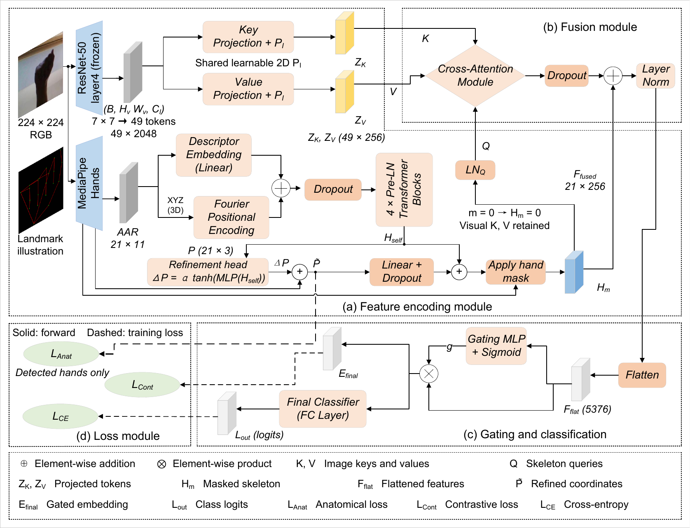

# SCG-VTNet: Skeleton-Guided Spatial Visual Feature Fusion

**中文** | [English](README_EN.md)

SCG-VTNet 是用于单帧静态手势识别的 PyTorch 实现。模型将手部关键点的解剖感知描述符与保留空间位置的视觉特征结合，让骨架特征通过交叉注意力查询图像中的局部信息。



图中的手部照片来自 Akash Nagaraj 的 [ASL Alphabet 数据集](https://doi.org/10.34740/KAGGLE/DSV/29550)，关键点插图由 MediaPipe Hands 检测结果绘制；第三方图像的使用遵循其原始许可，代码的 MIT 许可证不自动适用于该图像。

## 方法概览

- **空间视觉特征**：保留 ResNet-50 的 7 × 7 特征网格，将 49 个视觉 token 用作交叉注意力的键和值。
- **骨架引导融合**：将 21 个手部关键点编码为 11 维解剖感知描述符，通过骨架查询与视觉 token 融合，并使用全局门控进行分类。
- **检测失败处理**：未检测到手部时，模型使用与几何信息无关的学习查询，保留视觉分支。
- **辅助训练目标**：训练时结合分类、对比和解剖约束损失；相关组件的贡献见论文消融实验。

## 实验结果

下表数值为准确率（%，均值 ± 标准差）。连续分块评估使用一个固定划分上的三个训练种子；零样本迁移使用每个模型的五个源模型权重，目标集为 ASL Dataset 的 26 个共有字母类别。

| 评估条件 | SCG-VTNet | 等权视觉融合 | 后期融合 | EfficientNet-B0 |
| --- | ---: | ---: | ---: | ---: |
| ASL Alphabet 连续分块，全部测试图像 | 72.90 ± 1.38 | 69.74 ± 1.27 | 71.08 ± 0.54 | 58.44 ± 0.76 |
| 连续分块，已检测图像的固定视觉骨架置零 | 52.66 ± 1.63 | 41.12 ± 1.65 | 32.02 ± 1.51 | 不适用 |
| ASL Alphabet → ASL Dataset 零样本迁移 | 58.84 ± 0.50 | 未报告 | 53.17 ± 1.48 | 29.65 ± 1.56 |

连续分块和跨数据集迁移对应不同测试条件，不能直接比较表中各行的数值。数据划分、检测状态和其余基线详见论文及代码归档。

## 环境与安装

参考环境为 Python 3.10、PyTorch 2.7.1、torchvision 0.22.1、NumPy 1.26.4、pandas 2.2.2 和 MediaPipe 0.10.14。请先按设备安装合适版本的 PyTorch 和 torchvision，再安装项目依赖：

```bash
git clone https://github.com/Zhipeng220/SCG-VTNet.git
cd SCG-VTNet
python -m pip install -r requirements.txt
```

原图特征提取、图像退化和端到端计时还需要 MediaPipe、OpenCV、Pillow 和 tqdm；ViT-S/16 特征提取还需要 timm。依赖说明见 [`requirements.txt`](requirements.txt)。

## 数据准备

实验使用 [ASL Alphabet](https://www.kaggle.com/datasets/grassknoted/asl-alphabet) 和 [NUS Hand Posture](https://www.ece.nus.edu.sg/stfpage/elepv/NUS-HandSet/) 等数据集；跨数据集迁移使用 ASL Dataset。原始数据须从数据集提供方获取。

主仓库预期的数据、特征和划分位置，以及关键点与特征的样本顺序要求，见 [数据准备说明](docs/data_preparation.md)。冻结划分、预提取特征、逐图预测和训练权重独立于本代码仓库保存，可向作者申请。

## 训练与评估

v1.0.1 的模型、实验和评估源码位于仓库根目录的 `scg_vtnet/` 中，从仓库根目录运行：

```bash
python scg_vtnet/protocol/run_asl_blocked.py --help
python scg_vtnet/protocol/evaluate_asl_zero_shot.py --help
python scg_vtnet/protocol/evaluate_structured_swap.py --help
```

仓库还保留了模块化实现及其 `scripts/` 入口。模块化实现的数据布局和命令见 [实验复现指南](docs/reproduction.md)。不同入口使用的数据路径约定可能不同，请检查各脚本的参数。

## 项目结构

```text
SCG-VTNet/
├── scg_vtnet/             # 模型、特征提取、训练与评估源码
├── scripts/               # 数据提取、实验、分析与计时入口
├── configs/               # 实验配置和划分校验信息
├── docs/                  # 数据准备与实验复现说明
└── figures/               # 模型架构图
```

## 引用与代码归档

软件归档：[SCG-VTNet v1.0.1，Zenodo DOI 10.5281/zenodo.24529440](https://doi.org/10.5281/zenodo.24529440)。软件引用信息和作者信息见 [`CITATION.cff`](CITATION.cff)。

## 许可证

代码使用 [MIT License](LICENSE)。数据集及图中第三方图像的使用请遵循各自的许可和来源要求。
