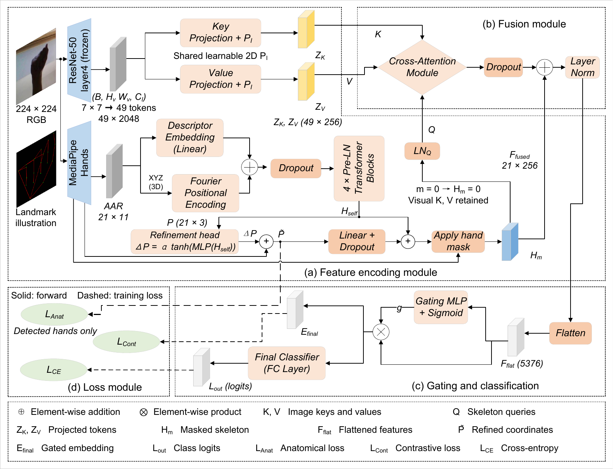

# SCG-VTNet: Skeleton-Guided Spatial Visual Feature Fusion

[中文](README.md) | **English**

SCG-VTNet is a PyTorch implementation for single-frame static hand gesture recognition. It combines anatomy-aware hand landmark descriptors with spatial visual features, using skeleton queries to attend to local image information.



The hand image in the diagram comes from Akash Nagaraj's [ASL Alphabet dataset](https://doi.org/10.34740/KAGGLE/DSV/29550); the landmark illustration was rendered from MediaPipe Hands detections. Third-party images are subject to their original licenses; the code's MIT license does not automatically apply to them.

## Method

- **Spatial visual features:** a preserved 7 × 7 ResNet-50 feature map provides 49 visual tokens as cross-attention keys and values.
- **Skeleton-guided fusion:** 21 hand landmarks are encoded as 11-dimensional anatomy-aware descriptors. Skeleton queries attend to visual tokens, followed by global gating and classification.
- **Detection failures:** when no hand is detected, learned geometry-independent queries retain the visual branch.
- **Auxiliary training objectives:** classification, contrastive, and anatomical losses are combined during training. Component contributions are evaluated in the ablation experiments.

## Results

Accuracy is reported as mean ± standard deviation (%). The contiguous-block evaluation uses three training seeds on one fixed split. Zero-shot transfer uses five source checkpoints per model on the 26 shared letters of ASL Dataset.

| Evaluation | SCG-VTNet | Uniform visual weighting | Late fusion | EfficientNet-B0 |
| --- | ---: | ---: | ---: | ---: |
| ASL Alphabet contiguous block, all test images | 72.90 ± 1.38 | 69.74 ± 1.27 | 71.08 ± 0.54 | 58.44 ± 0.76 |
| Contiguous block, fixed-visual skeleton zeroing on detected images | 52.66 ± 1.63 | 41.12 ± 1.65 | 32.02 ± 1.51 | N/A |
| ASL Alphabet → ASL Dataset zero-shot transfer | 58.84 ± 0.50 | Not reported | 53.17 ± 1.48 | 29.65 ± 1.56 |

Rows represent different evaluation conditions. See the experiment materials for split protocols, detection strata and additional baselines.

## Installation

The reference environment uses Python 3.10, PyTorch 2.7.1, torchvision 0.22.1, NumPy 1.26.4, pandas 2.2.2 and MediaPipe 0.10.14. Install the appropriate PyTorch and torchvision builds for your hardware first, then install the project dependencies:

```bash
git clone https://github.com/Zhipeng220/SCG-VTNet.git
cd SCG-VTNet
python -m pip install -r requirements.txt
```

Raw-image feature extraction, image degradation and end-to-end timing also require MediaPipe, OpenCV, Pillow and tqdm. ViT-S/16 feature extraction additionally requires timm. See [`requirements.txt`](requirements.txt).

## Data preparation

Experiments use datasets including [ASL Alphabet](https://www.kaggle.com/datasets/grassknoted/asl-alphabet) and [NUS Hand Posture](https://www.ece.nus.edu.sg/stfpage/elepv/NUS-HandSet/); cross-dataset transfer uses ASL Dataset. Obtain the original images from the dataset providers.

See [data preparation](docs/data_preparation.md) for the required data, features and splits. Frozen splits, pre-extracted features, per-image predictions and trained checkpoints are maintained separately and are available from the authors upon request. Landmark rows and feature arrays must have identical sample ordering.

## Training and evaluation

The v1.0.1 model, experiment and evaluation sources are in `scg_vtnet/`. Run the following from the repository root:

```bash
python scg_vtnet/protocol/run_asl_blocked.py --help
python scg_vtnet/protocol/evaluate_asl_zero_shot.py --help
python scg_vtnet/protocol/evaluate_structured_swap.py --help
```

The repository also retains a modular implementation and its `scripts/` entry points. See the [reproduction guide](docs/reproduction.md) for that implementation's data layout and commands. Input path conventions may differ between entry points; check each script's arguments.

## Project structure

```text
SCG-VTNet/
├── scg_vtnet/
│   ├── core/              # Model and figure scripts
│   ├── baselines/         # Baseline models and training
│   ├── extraction/        # Feature extraction
│   ├── protocol/          # Training and evaluation protocols
│   └── audit/             # Statistics and result verification
├── scripts/               # Modular implementation entry points
├── configs/               # Experiment and split checksums
├── docs/                  # Data and reproduction guides
└── figures/               # Model architecture diagram
```

## Citation and license

Software archive: [SCG-VTNet v1.0.1, Zenodo DOI 10.5281/zenodo.24529440](https://doi.org/10.5281/zenodo.24529440). Citation metadata is available in [`CITATION.cff`](CITATION.cff).

The code is distributed under the [MIT License](LICENSE). Dataset and third-party image use is subject to their respective licenses and attribution requirements.
